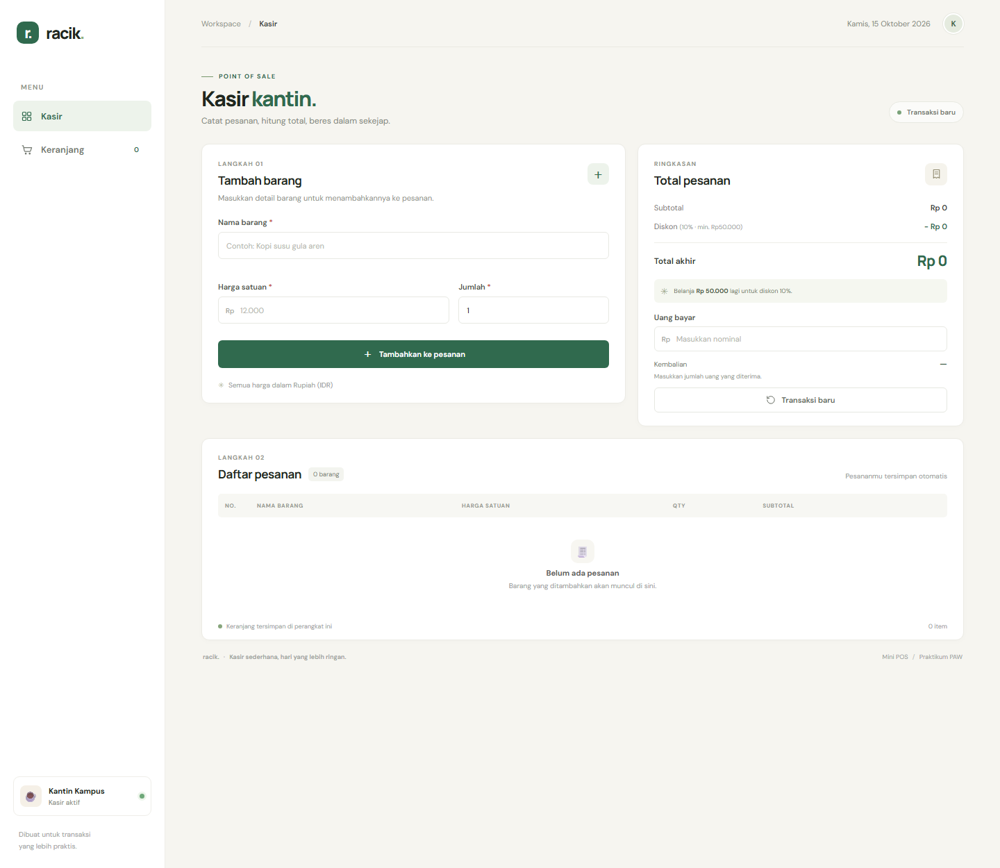
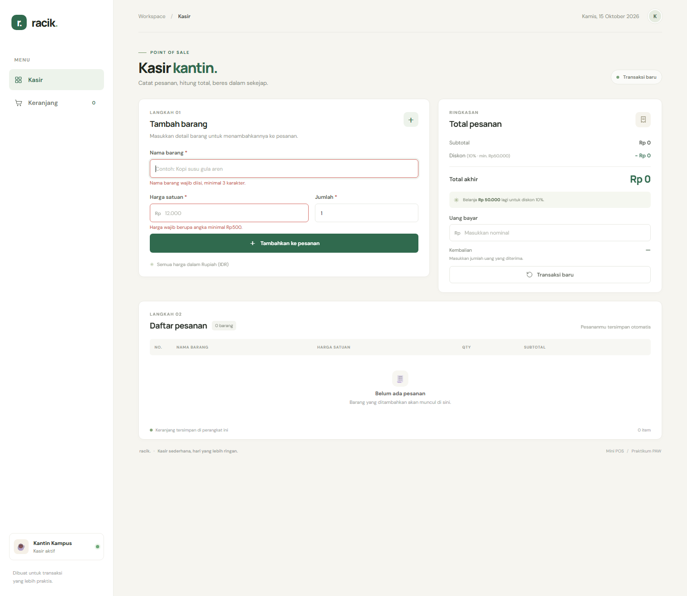
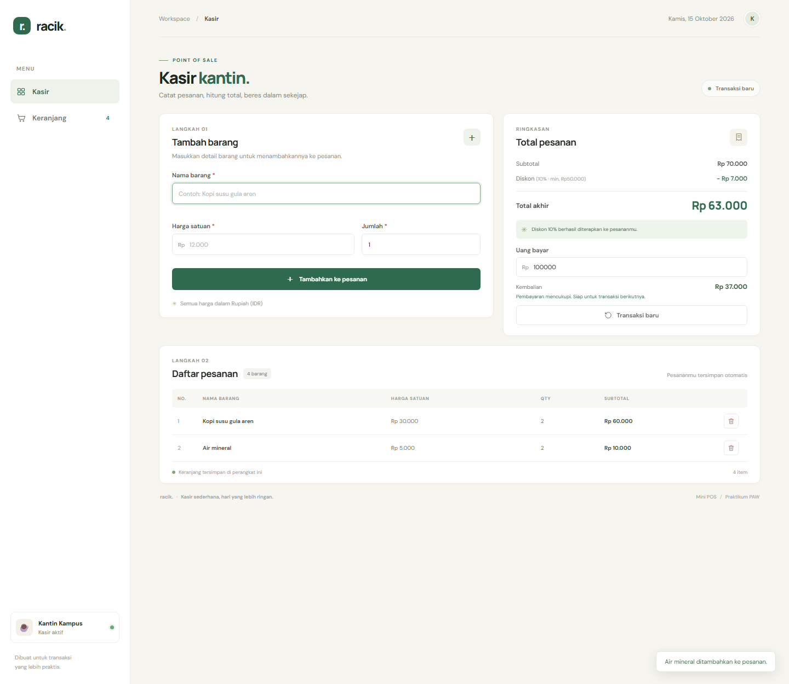

# Mini POS — Racik

## Identitas

- **Nama:** Nathania Hutapea
- **NIM:** 124140101
- **Kelas praktikum:** RA

> Nama dan NIM diisi berdasarkan konfigurasi Git lokal dan nama direktori proyek. Pastikan identitas serta kelas sudah benar sebelum pengumpulan.

## Deskripsi aplikasi

Racik adalah aplikasi kasir sederhana untuk kantin atau toko kampus. Aplikasi ini membantu kasir mencatat barang, melihat subtotal dan total pesanan, menerapkan diskon otomatis, serta menghitung kecukupan pembayaran dan kembalian. Proyek dibuat sebagai latihan validasi form, manipulasi DOM, fungsi, array/objek, dan penyimpanan persisten menggunakan `localStorage`.

## Menjalankan aplikasi

1. Buka folder `nathaniahutapea_124140101_pertemuan1` di VS Code.
2. Jalankan `index.html` menggunakan ekstensi **Live Server**, atau buka file tersebut langsung di browser modern.
3. Tambahkan barang melalui form. Keranjang akan tersimpan di browser yang sedang digunakan.

Tidak diperlukan instalasi dependency atau server backend. Font dari Google Fonts memerlukan koneksi internet; tanpa koneksi, aplikasi menggunakan font sistem sebagai fallback.

## Fitur

- [x] Validasi nama barang minimal 3 karakter, harga minimal Rp500, dan jumlah bilangan bulat minimal 1.
- [x] Pesan error merah pada field yang tidak valid; barang tidak ditambahkan sebelum seluruh data valid.
- [x] Form otomatis direset setelah barang berhasil ditambahkan.
- [x] Tabel keranjang dengan nomor, nama, harga satuan, qty, subtotal, dan tombol hapus.
- [x] Kalkulasi subtotal setiap baris dan total seluruh barang secara otomatis.
- [x] Diskon otomatis 10% untuk subtotal minimal Rp50.000.
- [x] Perhitungan kembalian langsung; kekurangan pembayaran ditampilkan secara jelas.
- [x] Penyimpanan keranjang memakai `JSON.stringify()` dan pemuatan dengan `JSON.parse()`.
- [x] Tombol transaksi baru mengosongkan keranjang dan nominal pembayaran.
- [x] Tata letak responsif untuk layar kecil dan dukungan aksesibilitas dasar.

## Screenshot

Tiga screenshot hasil menjalankan aplikasi tersedia di folder `screenshots/`:

### 1. Form input utama



### 2. Validasi input



### 3. Keranjang dan hasil pembayaran



## Penjelasan teknis

- `script.js` memasang event pada form, memvalidasi nilai input, lalu menambahkan objek barang ke array `cart`. Setiap field memiliki elemen error tersendiri; ketika validasi gagal, fokus berpindah ke input pertama yang perlu diperbaiki.
- `renderCart()` membangun isi tabel menggunakan DOM dan `textContent`, serta memperbarui jumlah item. `calculateTotals()` memakai `reduce()` untuk menjumlahkan subtotal dan menentukan diskon 10% jika ambang Rp50.000 tercapai.
- `updatePayment()` membandingkan nominal bayar dengan total akhir. Jika kurang, label berubah menjadi kekurangan; jika cukup, selisihnya ditampilkan sebagai kembalian.
- `saveCart()` menserialisasi array dengan `JSON.stringify()` ke `localStorage`. Saat halaman dimuat, `loadCart()` memulihkannya memakai `JSON.parse()` dan memeriksa bentuk data sebelum dipakai. Penghapusan barang juga langsung menyimpan ulang keranjang.

## Struktur proyek

```text
nathaniahutapea_124140101_pertemuan1/
├── index.html
├── style.css
├── script.js
├── README.md
├── modul/
│   ├── latihan-array.html
│   └── latihan-array.js
└── screenshots/                 # 3 screenshot aplikasi
```
