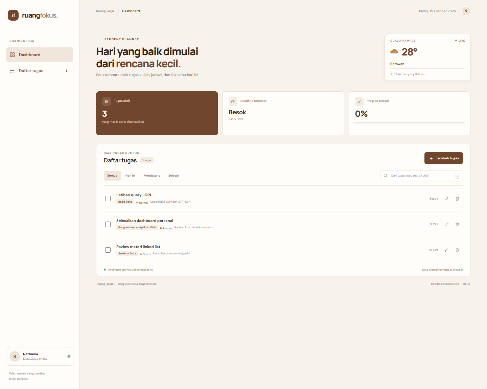
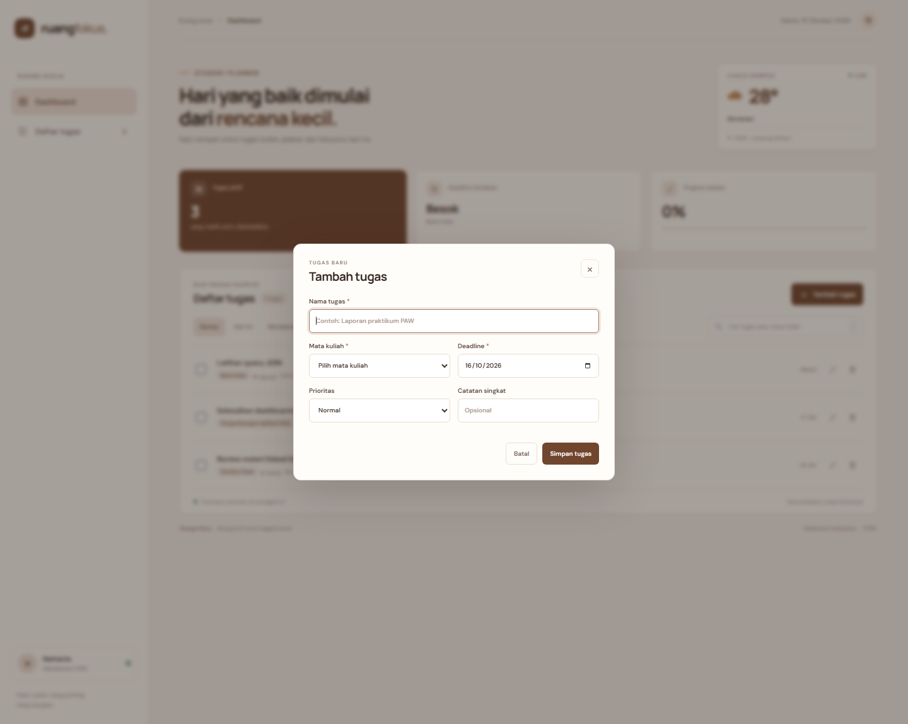
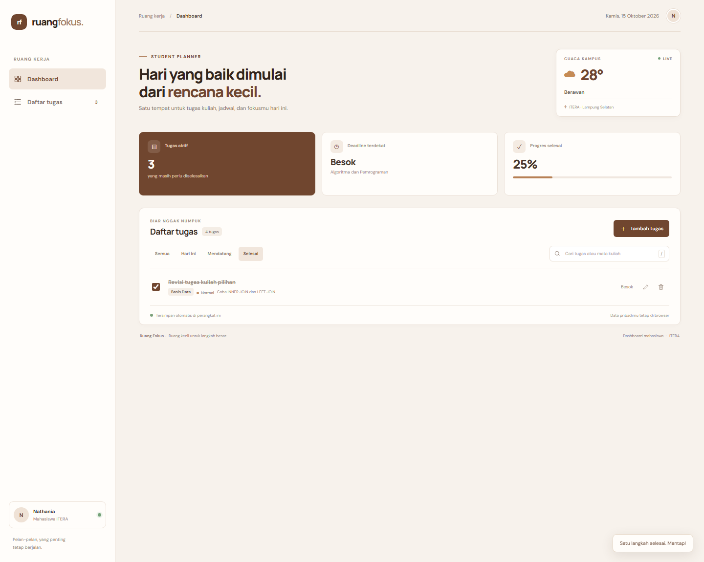

# Ruang Fokus — Personal Dashboard Mahasiswa

## Identitas

- **Nama:** Nathania Hutapea
- **NIM:** 124140101
- **Kelas praktikum:** RA

## Deskripsi

Ruang Fokus adalah dashboard ringan untuk membantu mahasiswa ITERA mengatur tugas kuliah tanpa berpindah-pindah aplikasi. Tugas dapat dikelompokkan berdasarkan mata kuliah, diberi deadline dan prioritas, dicari, ditandai selesai, diedit, atau dihapus. Widget cuaca kampus mengambil kondisi terkini di ITERA, sementara seluruh data tugas disimpan di browser pengguna.

## Fitur

- [x] Ringkasan jumlah tugas aktif, deadline terdekat, dan progres penyelesaian.
- [x] Tambah dan edit tugas melalui form dialog dengan validasi judul, mata kuliah, dan deadline.
- [x] Tandai tugas selesai atau aktif kembali, serta hapus tugas.
- [x] Filter tugas: semua, hari ini, mendatang, dan selesai.
- [x] Pencarian berdasarkan judul, mata kuliah, atau catatan; tekan `/` untuk fokus ke kolom pencarian.
- [x] Penyimpanan otomatis menggunakan `localStorage`, termasuk tugas contoh saat pertama kali dibuka.
- [x] Cuaca real-time kampus ITERA melalui Open-Meteo, tanpa API key; tersedia pesan fallback bila koneksi gagal.
- [x] Layout responsif dan feedback toast untuk aksi pengguna.

## Cara menjalankan

1. Buka folder `nathaniahutapea_124140101_pertemuan2` di VS Code.
2. Jalankan `index.html` dengan ekstensi **Live Server** agar `fetch()` dan penyimpanan browser berjalan konsisten.
3. Pastikan internet tersedia untuk memuat font dan data cuaca. Fitur pengelolaan tugas tetap dapat digunakan offline setelah halaman terbuka.

Tidak ada dependency atau server backend yang perlu dipasang. Data tugas hanya berada di `localStorage` pada browser/perangkat yang digunakan dan tidak dikirim ke server.

## Screenshot

### Dashboard utama

### Form tambah tugas

### Tugas yang sudah selesai

## Fitur ES6+ dan lokasi kode

Nomor baris mengacu ke `script.js`.

| Fitur | Implementasi |
| --- | --- |
| `const` dan `let` | Konfigurasi/helper: baris 1–46; `let nextTask` dipakai saat mencari deadline terdekat: baris 220–224. |
| Arrow functions (lebih dari 3) | Helper tanggal dan sanitasi: baris 27–46; event handler serta filter: baris 154–192. |
| Template literals | Ringkasan dinamis dan kartu tugas: baris 265–267, 297–313. |
| Async/await dan `fetch()` | `loadWeather()` memuat Open-Meteo dan menangani kegagalan: baris 407–420. |
| Classes | `TaskItem` untuk model data: baris 48–82; `DashboardApp` untuk state, UI, penyimpanan, dan API: mulai baris 84. |
| Destructuring | Parameter constructor dan data cuaca: baris 49–58, 411. |
| Spread operator dan update immutable | Memperbarui/menambahkan tugas tanpa mutasi array: baris 361–375; tandai selesai: baris 379–385. |
| `localStorage` + JSON | Membaca dan memvalidasi data: baris 120–123; simpan otomatis dengan `JSON.stringify()`: baris 204–206. |

## Catatan teknis

- Saat pertama dibuka, aplikasi membuat beberapa tugas contoh dan langsung menyimpannya. Setelah itu, daftar dibaca dari `localStorage` dan hanya diperbarui saat pengguna melakukan aksi.
- `TaskItem` menormalisasi setiap item dan memeriksa data yang dipulihkan. `DashboardApp` mengelola state, render, dialog CRUD, pencarian, filter, ringkasan progres, dan penyimpanan.
- Widget cuaca menggunakan endpoint `https://api.open-meteo.com/v1/forecast?latitude=-5.36&longitude=105.31&current_weather=true`. Permintaan dibatasi waktu tunggu 8 detik; ketika gagal, aplikasi tetap berjalan dan menampilkan pesan yang sesuai.
