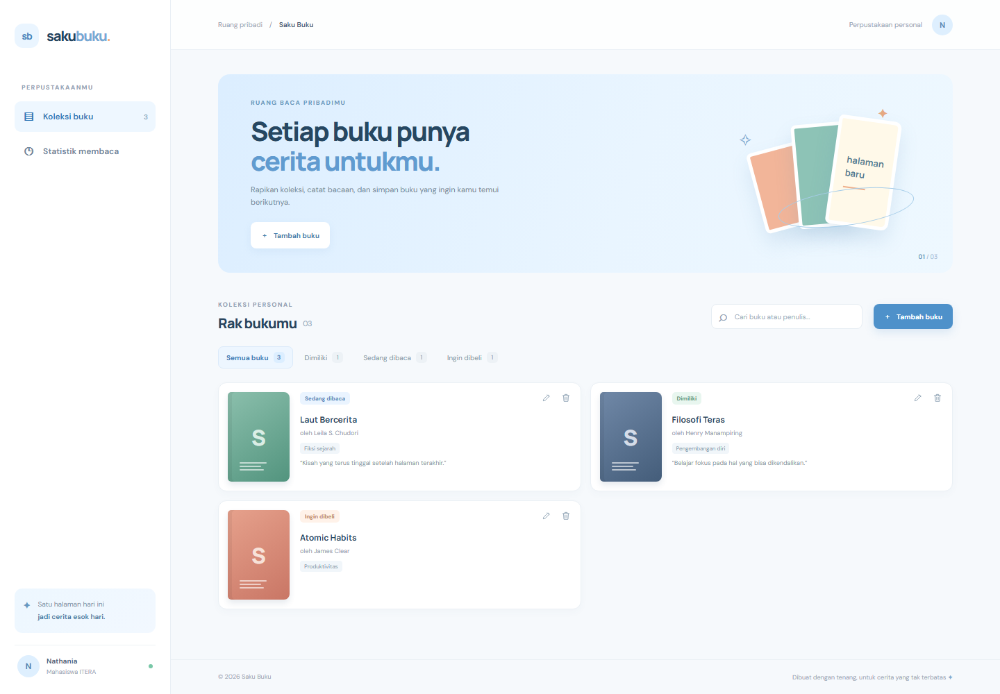
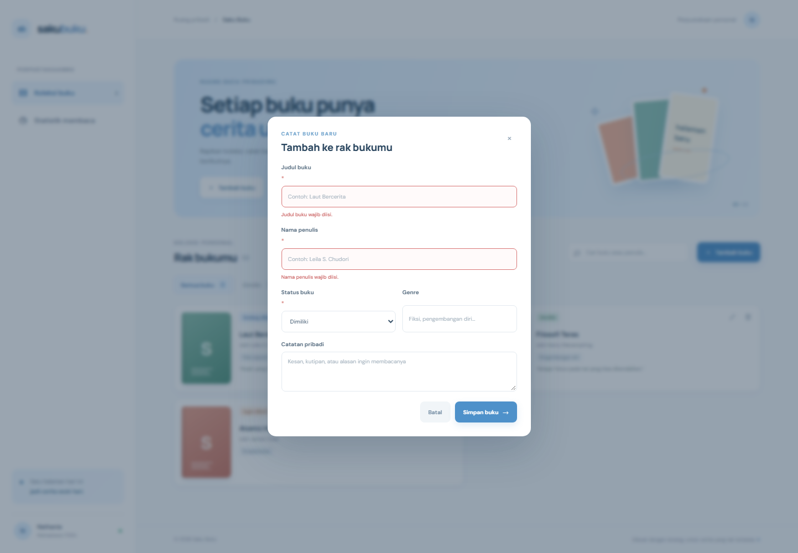
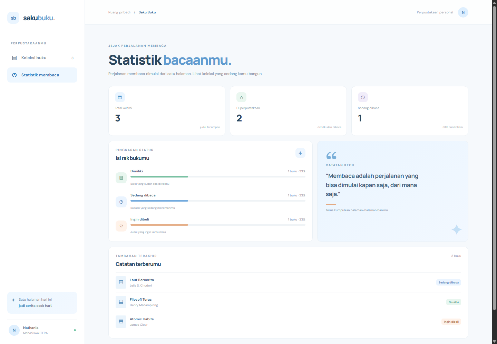
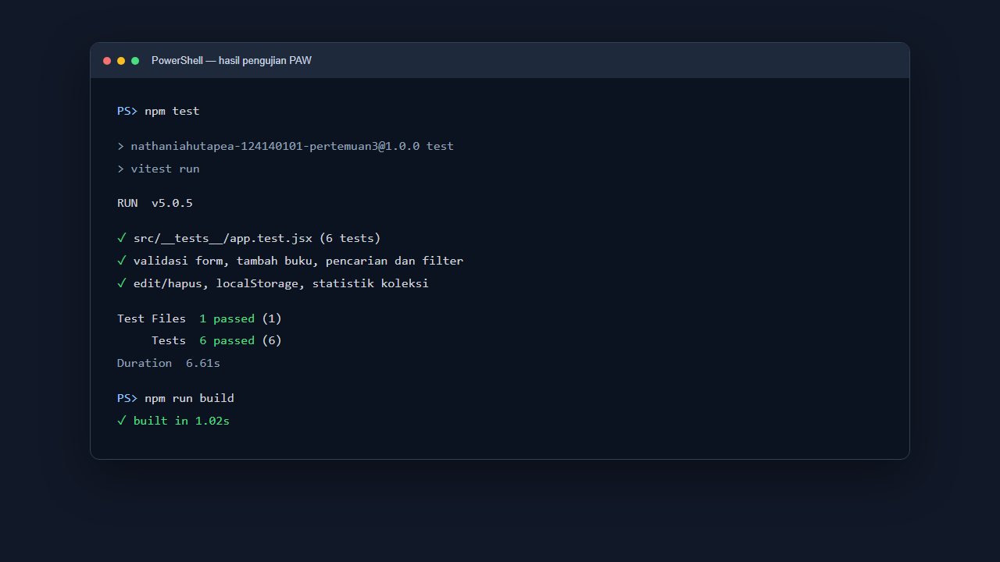

# Saku Buku — Manajemen Buku Pribadi

## Identitas

- **Nama:** Nathania Hutapea
- **NIM:** 124140101
- **Kelas praktikum:** RA
- **Mata kuliah:** Pemrograman Aplikasi Web (PAW)

## Deskripsi

Saku Buku adalah aplikasi perpustakaan pribadi untuk membantu mahasiswa mencatat buku yang sudah dimiliki, sedang dibaca, maupun ingin dibeli. Koleksi dapat dikelola dari satu halaman, dicari berdasarkan judul atau penulis, dan dilihat ringkasannya melalui halaman statistik. Data disimpan di `localStorage`, sehingga tetap tersedia setelah halaman dimuat ulang.

## Fitur

- [x] Menambahkan buku dengan judul, penulis, status, genre opsional, dan catatan pribadi.
- [x] Memvalidasi judul serta penulis yang wajib diisi dan menampilkan pesan kesalahan di formulir.
- [x] Mengedit data dan menghapus buku dengan konfirmasi.
- [x] Memfilter koleksi berdasarkan status: dimiliki, sedang dibaca, atau ingin dibeli.
- [x] Mencari buku berdasarkan judul maupun nama penulis.
- [x] Menyimpan dan memuat koleksi menggunakan `localStorage` serta JSON.
- [x] Menampilkan ringkasan koleksi dan statistik status pada halaman terpisah.
- [x] Menggunakan React Router, Context API, dua custom hooks, dan komponen reusable.
- [x] Tampilan responsif untuk desktop dan perangkat seluler.
- [x] Unit test menggunakan Vitest dan React Testing Library.

## Teknologi

React 19, Vite, React Router 7, PropTypes, Vitest, React Testing Library, dan CSS.

## Instalasi dan menjalankan aplikasi

Pastikan Node.js versi LTS dan npm telah terpasang. Dari folder tugas ini jalankan:

```bash
npm install
npm run dev
```

Buka alamat lokal yang dicetak oleh Vite (umumnya `http://localhost:5173`). Untuk memeriksa hasil produksi:

```bash
npm test
npm run build
npm run preview
```

Data buku disimpan pada `localStorage` browser di kunci `saku-buku-library`. Hapus data situs/browser untuk mengosongkan penyimpanan secara manual.

## Screenshot aplikasi

> Screenshot antarmuka disimpan dalam folder [`screenshots/`](./screenshots/); gambar hasil test menampilkan ringkasan eksekusi `npm test` dan `npm run build` yang berhasil.

### Koleksi buku dan form input



### Validasi form



### Statistik membaca



### Hasil unit test



## Implementasi React dan fitur JavaScript

- **Functional components dan Hooks:** halaman dan UI dibuat sebagai komponen fungsional; `useState`, `useEffect`, `useMemo`, dan `useCallback` mengelola form, navigasi koleksi, persistence, dan kalkulasi statistik.
- **Reusable components:** `BookForm`, `BookCard`, `BookList`, `BookFilter`, `Navigation`, dan `StatCard` memisahkan bagian UI.
- **Context API:** `BookProvider` menyediakan koleksi dan operasi tambah, ubah, serta hapus melalui hook `useBooks()`.
- **React Router:** `App.jsx` menyediakan halaman koleksi (`/`), statistik (`/stats`), dan halaman tidak ditemukan.
- **Custom hooks:** `src/hooks/useLocalStorage.js` menginisialisasi state dari JSON localStorage, lalu menyinkronkan perubahan; `src/hooks/useBookStats.js` menghitung jumlah buku dan progres berdasarkan status.
- **PropTypes:** komponen, halaman, dan provider memiliki deklarasi PropTypes untuk memeriksa props.
- **ES6+:** `const`/`let`, arrow functions, template literals, destructuring props/parameter, optional chaining, nullish coalescing, dan spread operator digunakan di modul aplikasi.
- **Pengujian:** enam unit test mencakup validasi, tambah, pencarian/filter, edit/hapus, penyimpanan dan pemuatan ulang, serta statistik.

### Lokasi kode penting

| Konsep | Lokasi |
| --- | --- |
| Router dan kerangka aplikasi | [`src/App.jsx`](./src/App.jsx) |
| Form dan validasi | [`src/components/BookForm.jsx`](./src/components/BookForm.jsx) |
| Penyimpanan Context dan CRUD | [`src/context/BookContext.jsx`](./src/context/BookContext.jsx) |
| Hook localStorage | [`src/hooks/useLocalStorage.js`](./src/hooks/useLocalStorage.js) |
| Hook statistik | [`src/hooks/useBookStats.js`](./src/hooks/useBookStats.js) |
| Halaman koleksi dan pencarian | [`src/pages/Home.jsx`](./src/pages/Home.jsx) |
| Halaman statistik | [`src/pages/Stats.jsx`](./src/pages/Stats.jsx) |
| Unit test | [`src/__tests__/app.test.jsx`](./src/__tests__/app.test.jsx) |

## Laporan pengujian

Perintah yang digunakan:

```bash
npm test
npm run build
```

Rincian aktual eksekusi dan bukti tangkapan terminal tersedia di [`screenshots/hasil-test.png`](./screenshots/hasil-test.png). Test menguji perilaku UI melalui React Testing Library, bukan hanya fungsi terisolasi.
