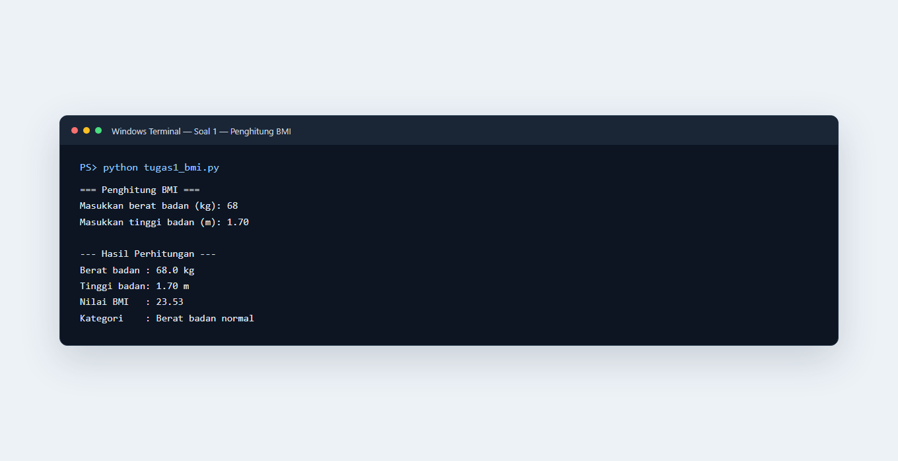
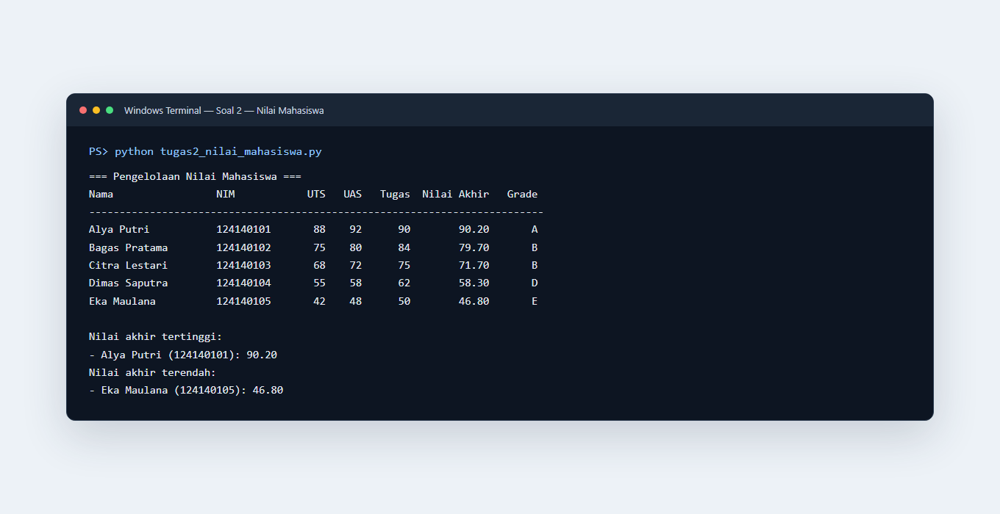
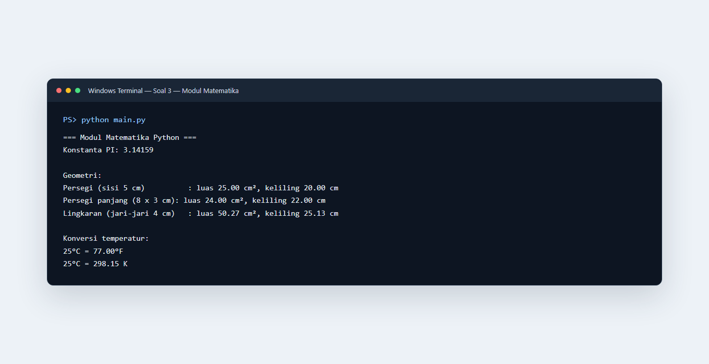

# Praktikum PAW — Dasar Pemrograman Python

## Identitas

- **Nama:** Nathania Hutapea
- **NIM:** 124140101
- **Kelas praktikum:** RA

## Deskripsi

Folder ini berisi latihan variabel, percabangan, perulangan, fungsi, list, dictionary, dan modul Python.

1. **`tugas1_bmi.py` — Penghitung BMI**
   Meminta berat badan dalam kilogram dan tinggi dalam meter, memvalidasi input angka positif, menghitung BMI, lalu menentukan kategori kurang, normal, berlebih, atau obesitas.
2. **`tugas2_nilai_mahasiswa.py` — Pengelolaan nilai**
   Mengelola lima dictionary mahasiswa di dalam list, menghitung nilai akhir dengan bobot UTS 30%, UAS 40%, dan tugas 30%, menentukan grade A–E, mencetak tabel, serta menemukan nilai tertinggi dan terendah.
3. **`math_operations.py` dan `main.py` — Modul matematika**
   Modul menyediakan perhitungan luas dan keliling persegi, persegi panjang, serta lingkaran, dan konversi Celsius ke Fahrenheit/Kelvin. `main.py` mengimpor fungsi dengan dua cara berbeda dan menampilkan contoh penggunaannya.

Semua fungsi dilengkapi docstring untuk menjelaskan input dan nilai kembali. Program menggunakan indentasi empat spasi, nama variabel `snake_case`, serta hanya modul standar Python sehingga tidak perlu memasang dependensi tambahan.

## Cara menjalankan

Pastikan Python 3 telah terpasang. Buka terminal pada folder `nathaniahutapea_124140101_pertemuan4`, lalu jalankan program sesuai tugas:

```bash
python tugas1_bmi.py
python tugas2_nilai_mahasiswa.py
python main.py
```

Program BMI meminta input berat dan tinggi. Contoh: masukkan `68` untuk berat badan dan `1.70` untuk tinggi badan. Kedua program lainnya langsung mencetak hasil contoh ke terminal.

## Screenshot hasil eksekusi

### Soal 1 — Penghitung BMI



### Soal 2 — Tabel nilai mahasiswa



### Soal 3 — Modul matematika



## Pengujian

Skrip dijalankan menggunakan Python 3.14.6. Pemeriksaan sintaks dan contoh eksekusi dilakukan dengan:

```bash
python -m compileall -q tugas1_bmi.py tugas2_nilai_mahasiswa.py math_operations.py main.py
python tugas1_bmi.py
python tugas2_nilai_mahasiswa.py
python main.py
```

Hasil contoh BMI: 68 kg dan 1,70 m menghasilkan BMI **23,53** dengan kategori **Berat badan normal**. Program nilai menampilkan lima mahasiswa, termasuk peraih nilai tertinggi dan terendah.
