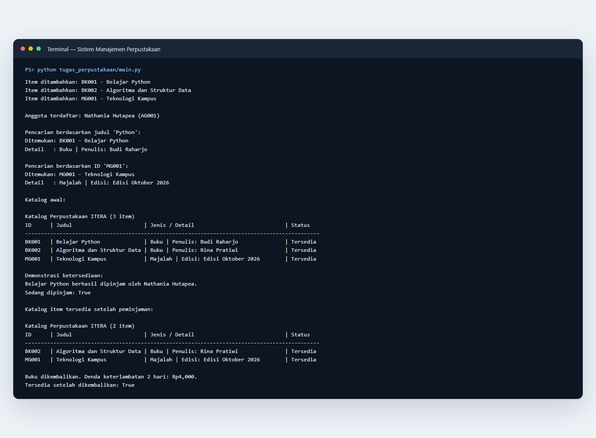

# Praktikum PAW Pertemuan 5 — Sistem Manajemen Perpustakaan

## Identitas Mahasiswa

- **Nama:** Nathania Hutapea
- **NIM:** 124140101
- **Kelas Praktikum:** RA

## Deskripsi Program

Program konsol ini mengelola buku dan majalah pada perpustakaan sederhana. Program menambahkan beberapa item dan seorang anggota, menampilkan katalog, mencari item melalui judul atau ID, meminjam serta mengembalikan item, dan menunjukkan status ketersediaan serta denda keterlambatan.

### Penerapan empat pilar OOP

1. **Class dan object** — `LibraryItem`, `Book`, `Magazine`, `Member`, dan `Library` menjadi cetak biru; `main.py` membuat instance dari kelas-kelas tersebut.
2. **Inheritance** — `Book` dan `Magazine` mewarisi atribut serta perilaku dasar `LibraryItem` melalui `super().__init__()`.
3. **Encapsulation** — atribut penting menggunakan nama private, misalnya `LibraryItem.__item_id`, `LibraryItem.__is_dipinjam`, `Member.__borrowed_item_ids`, dan `Library.__koleksi`. Akses yang diperlukan disediakan melalui property dan method.
4. **Polymorphism** — `Book` dan `Magazine` memiliki implementasi berbeda untuk method abstrak `get_detail()` dan `hitung_denda()`. Katalog memanggil `get_detail()` secara seragam pada setiap item, sedangkan pengembalian memakai tarif denda sesuai jenis item.

`LibraryItem` merupakan abstract class berbasis `ABC`. Property `is_dipinjam` menyediakan status read-only, sedangkan `Library.jumlah_item` menunjukkan jumlah item katalog. Class `Member` menyimpan peminjaman secara privat dan membantu proses pinjam/kembali.

## Struktur Berkas

```text
nathaniahutapea_124140101_pertemuan5/
├── latihan/
│   ├── 01_everything_is_object.py
│   ├── 01_procedural_vs_oop.py
│   ├── 02_class_object.py
│   ├── 03_inheritance.py
│   ├── 04_encapsulation.py
│   ├── 05_polymorphism.py
│   └── 06_abstract_class.py
├── tugas_perpustakaan/
│   ├── library_item.py
│   ├── member.py
│   ├── library.py
│   └── main.py
├── screenshots/
├── .gitignore
└── README.md
```

## Menjalankan Program

Pastikan Python 3 terpasang. Dari folder `nathaniahutapea_124140101_pertemuan5`, jalankan:

```bash
python tugas_perpustakaan/main.py
```

Untuk menjalankan salah satu latihan, gunakan contoh berikut:

```bash
python latihan/03_inheritance.py
```

Tidak ada dependensi tambahan. File `.gitignore` mengecualikan `__pycache__/`, file bytecode, dan virtual environment.

## Screenshot Output

Output berikut memperlihatkan penambahan buku/majalah, pencarian berdasarkan judul dan ID, katalog, serta perubahan status ketersediaan saat item dipinjam dan dikembalikan.



## Catatan Implementasi

Setiap class dan method penting memiliki docstring. Denda buku adalah Rp2.000 per hari, sedangkan denda majalah Rp1.500 per hari. Input ID ganda, item yang sedang dipinjam, dan keterlambatan negatif ditangani dengan pengecekan atau pesan error yang sesuai.
