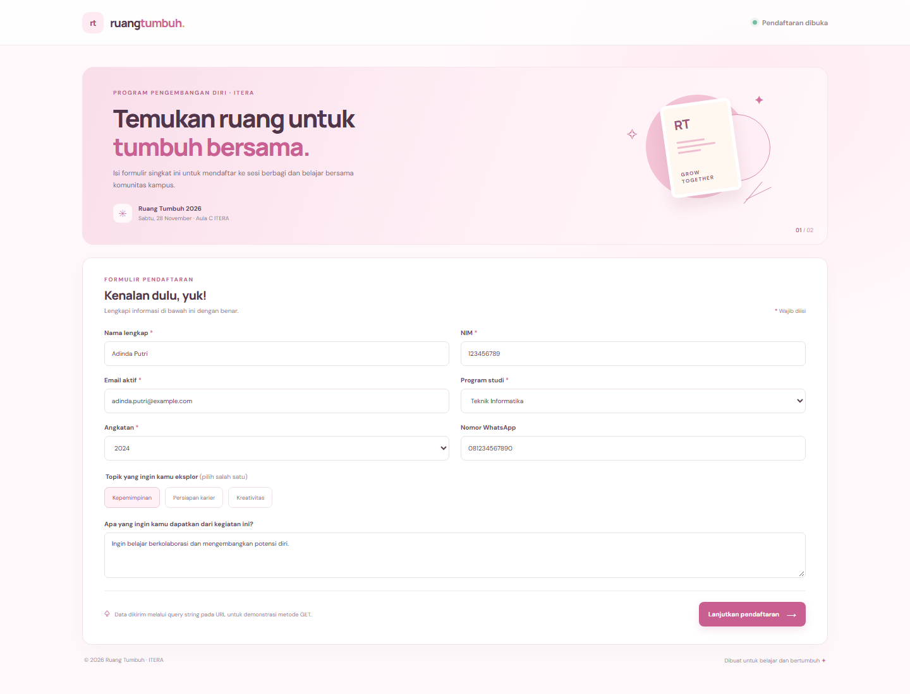
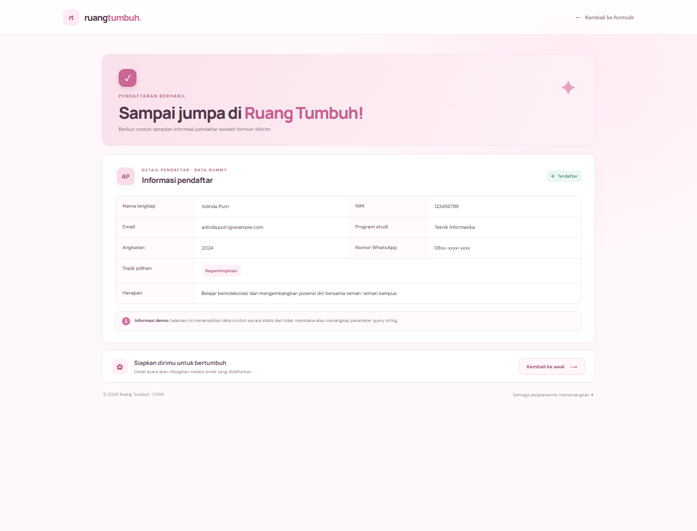

# Tugas Individu 3 — Form Pendaftaran GET

## Identitas

- **Nama:** Nathania Hutapea
- **NIM:** 124140101
- **Kelas:** RA

## Deskripsi

Website bertema kegiatan kampus **Ruang Tumbuh** memiliki dua halaman: formulir pendaftaran dan halaman detail pendaftar dengan data dummy. Form menggunakan `method="get"` dan mengirim nilai field ke `detail.html` melalui query string. Halaman detail bersifat statis: tidak memakai JavaScript, tidak membaca query string, dan tidak mengubah data dummy berdasarkan input form.

Contoh query string yang dibentuk browser ketika formulir diisi:

```text
detail.html?nama=Nathania+Hutapea&nim=124140101&email=nathania%40email.com&program_studi=Teknik+Informatika&angkatan=2024&topik=kepemimpinan
```

## Struktur

- `index.html` — form pendaftaran dengan atribut `action="detail.html"` dan `method="get"`.
- `detail.html` — desain detail pendaftar yang isinya dummy/statis, tidak menangkap query string.
- `style.css` — desain responsif untuk form, kartu, tabel, tombol, dan elemen visual lainnya.
- [`RA-Nathania-124140101-Tugas3-Pemweb.pdf`](./RA-Nathania-124140101-Tugas3-Pemweb.pdf) — dokumen pengumpulan dua halaman.
- `screenshots/` — screenshot kedua halaman.

## Menjalankan

Buka `index.html` langsung di browser, atau jalankan server lokal dari folder `task_3`:

```bash
python -m http.server 8000
```

Lalu buka `http://localhost:8000`. Isi form dan tekan **Lanjutkan pendaftaran** untuk melihat query string di address bar. Halaman detail tetap menampilkan data dummy yang sama karena query string memang tidak dibaca.

## Bukti tampilan

### Halaman pendaftaran



### Halaman detail informasi pendaftar (data dummy)



## Implementasi CSS

Stylesheet menerapkan selector elemen (`body`, `a`, `input`, `button`), selector kelas (`.form-card`, `.field`, `.detail-card`), selector pseudo-class (`:focus-visible`, `:hover`, `:checked`), serta media query untuk layar kecil. Layout mencakup form, kartu informasi, tabel detail, dan elemen box.
